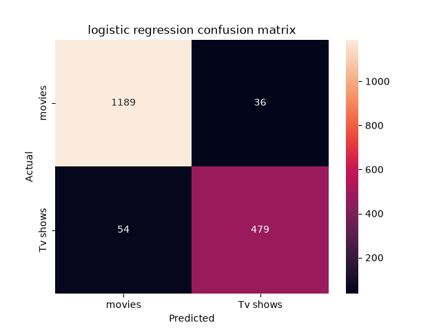
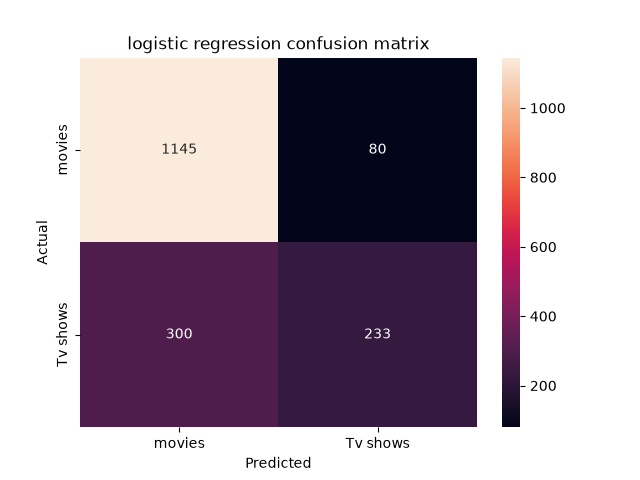
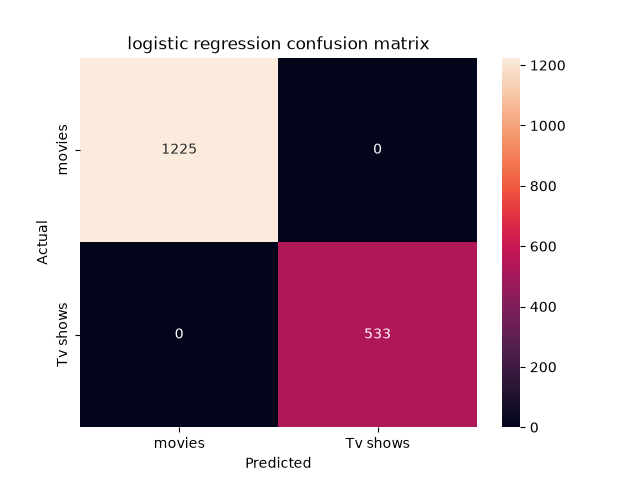

# Task 2: Content Type Prediction Model

## What is this?
This is a content type prediction model. It predicts whether a Netflix title is a **Movie** or a **TV Show** using the title's other attributes. The dataset has 8,790 titles (about 70% movies and 30% TV shows).

## What did I do?
1. **Cleaning the data**
   - Replaced the placeholder value `Not Given` in `director` and `country` with real missing values.
   - Extracted `year_added` and `month_added` from the `date_added` column.
   - Extracted `main_country` (the first country listed) from `country`.
   - Extracted `duration_min` (movies) and `n_seasons` (TV shows) from `duration`.
   - Split the genres into separate columns instead of one column (used in the cleaning step, not in this model).
2. **Preparing the data**
   - The target is `type`, where TV Show = 1 and Movie = 0.
   - The features of the main model are: `release_year`, `year_added`, `month_added`, `rating`, `main_country`, `director`.
   - I did not use `duration_min` and `n_seasons` in the main model, because they give the answer directly (data leakage). I tested this separately in Experiment 3.
   - Split the data 80% train / 20% test (stratified, so both sets keep the same Movie/TV Show ratio).
   - Encoded the text columns with One-Hot Encoding and scaled the numeric columns with StandardScaler (scikit-learn). For `main_country` and `director` I kept the 20 most frequent values and grouped the rest as `Other`.
3. **Training models**
   I trained three models: Logistic Regression, Decision Tree, and Random Forest.

## Results

### Experiment 1: Main model (with `director`, without `duration`)

| Model | Accuracy | F1 |
|---|---|---|
| Logistic Regression | 0.949 | 0.914 |
| Decision Tree | 0.931 | 0.886 |
| Random Forest | 0.941 | 0.902 |

Confusion matrix (Logistic Regression):

### Experiment 2: Without `director`

| Model | Accuracy | F1 |
|---|---|---|
| Logistic Regression | 0.784 | 0.551 |
| Decision Tree | 0.765 | 0.588 |
| Random Forest | 0.783 | 0.622 |

Confusion matrix (Logistic Regression):

### Experiment 3: With `duration_min` and `n_seasons` (data leakage test)

| Model | Accuracy | F1 |
|---|---|---|
| Logistic Regression | 1.000 | 1.000 |
| Decision Tree | 1.000 | 1.000 |
| Random Forest | 1.000 | 1.000 |

Confusion matrix (Logistic Regression):

### Summary (Logistic Regression)

| Experiment | Accuracy | F1 |
|---|---|---|
| Without `director` | 0.784 | 0.551 |
| Main model (with `director`) | 0.949 | 0.914 |
| With `duration_min` and `n_seasons` | 1.000 | 1.000 |

## What I found
Removing the `director` feature makes the model much weaker. With `director`, Logistic Regression reaches an accuracy of 0.949 and an F1 score of 0.914. Without it, the accuracy drops to 0.784 and the F1 score drops to 0.551.

The recall for TV shows also dropped from 0.90 to 0.44. This means that without `director` the model misses most TV shows (300 out of 533) and predicts "Movie" for them.

## Why?
The `director` feature is very important in this dataset, but not because of the director's name. What matters is whether the director is **missing**. About 97% of movies have a director listed, while about 91% of TV shows do not. So a missing director tells the model that a title is probably a TV show.

## Data leakage experiment
When I added `duration_min` and `n_seasons`, all three models reached 100% accuracy with zero errors. This is **data leakage**: every movie has a value in `duration_min` and every TV show has a value in `n_seasons`, so these columns give the answer directly. The model did not learn anything useful, it just read the answer. For this reason I do not count this result as a real achievement, and the main model does not use these two features.
